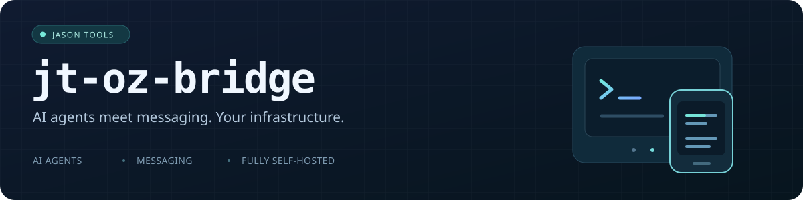
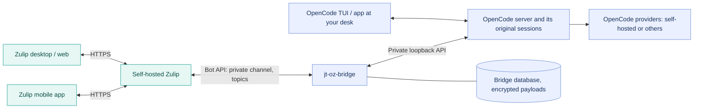

<p align="center">
  
</p>

<h1 align="center">jt-oz-bridge</h1>

<p align="center"><strong>Talk to your AI coding agent from chat.<br>OpenCode × Zulip, self-hosted on your own infrastructure.</strong></p>

<p align="center">
  
  
  <a href="LICENSE"></a>
  
</p>

<p align="center">English · <a href="README_zh-tw.md">繁體中文</a> · <a href="README_ja.md">日本語</a></p>

**Bring AI agents into everyday conversations, on infrastructure you own.** jt-oz-bridge connects AI agents with messaging software. It starts with **OpenCode × Zulip**: type a task in a Zulip topic, watch the agent work, answer its permission requests from your phone and receive the complete result, all in the same OpenCode session you also use at your desk.

Zulip, the bridge, OpenCode and your model servers can all run on your own equipment. With a self-hosted model server configured in OpenCode (for example Ollama), messaging, agent execution and inference form a fully local workflow.

[Why](#why-jt-oz-bridge) · [Architecture](#how-it-fits-together) · [Commands](#chat-commands) · [Install](#install-upgrade-and-uninstall) · [Security](#security-model) · [Development](#development-quick-start) · [Testing](#testing-and-release-gates) · [Documentation](#documentation) · [License](#license)

> **Status: development preview `0.1.0`.**  
> This is not a finished production release. Core routing, persistence and security boundaries have a large automated test suite, and parts of the flow have been observed against a real OpenCode server and Zulip organization. Complete end-to-end acceptance by real people and official iOS/Android acceptance are **not** complete. Expect changes, and try it on a disposable project first.

---

## Why jt-oz-bridge?

| Focus | What it enables |
|---|---|
| **AI agents in everyday conversations** | Tasks, progress, questions and results stay together in your chat, on your phone and your computer. |
| **OpenCode × Zulip** | OpenCode runs the agent and its tools; Zulip provides mobile/desktop chat, private channels and topic threads. |
| **Fully self-hosted** | Run messaging, the bridge, the agent and the models on your own hardware, and keep control of every data flow. |
| **The same session, not a copy** | Each topic is bound to an existing OpenCode session. The bridge never copies history, forks a session or starts a second backend to fake continuity. |
| **Approvals from your phone** | OpenCode permission requests and questions arrive in the topic; answer with a short command or a button. |
| **Your models and tools** | Choose providers, models and variants from OpenCode's own catalog, including your existing MCP configuration. |

OpenCode × Zulip is the first integration. Connecting other AI agents and messaging platforms is the broader direction; it is not implemented yet.

## How it fits together



| Component | Role |
|---|---|
| `jt-oz-bridge serve` | The bridge service: consumes Zulip events, checks authorization, talks to the OpenCode API, delivers results. Listens on loopback (`127.0.0.1:8765`) for health, readiness and the optional admin pages. |
| Bridge database | Its own SQLite database (PostgreSQL support is in development) with application-level encryption of message payloads. OpenCode's own database is never opened. |
| `jt-oz-bridge observe-serve` | Optional read-only local observer behind `jt-oz-bridge sessions` and `doctor` on the OpenCode host. |
| Owner and directory helpers | Small standard-library services, run as the OpenCode account, that prove which OpenCode process, dataset and project directory are the real ones without reading OpenCode's data. |
| Stop notice units | Optional units that post one notice to Zulip when the bridge stops and one when it is back. |

OpenCode stays private. Starting, stopping or upgrading the bridge never starts, restarts or replaces OpenCode, and work already running in OpenCode keeps running.

### One topic, one session

```text
private channel "project-a"
├── login fix     → existing OpenCode session A
└── API tests     → existing OpenCode session B
```

Open a topic, pick an existing session you are allowed to use (or start a new one in an enrolled project), and type. Everyone in the channel can read its topics, so projects with different audiences need different private channels.

## Capabilities and current proof

| Area | Implemented | Verification boundary |
|---|---|---|
| Original sessions | Authorized discovery, selection, binding and identity checks; automatic reconnect after an OpenCode restart when the same session can be proven | Observed against a real server; full computer/phone continuation acceptance pending |
| Prompts and queue | Source rechecks, follow-up messages to a running reply, pause/resume, one-attempt dispatch, catch-up after a bridge restart | Bot-driven checks pass; real-human end-to-end acceptance pending |
| Activity | Zulip's native typing indicator while the agent works; tool progress edited in place, with a repeated step counted instead of reposted and one ⚠️ `!stop` suggestion when it repeats 5 times; one ⏳ "still working" line when a running turn has shown nothing for 2 minutes, saying whether it waits on a tool or on the model; one 💡 suggestion to start a new conversation once a reply's context reaches 60,000 tokens | Development candidate; server and phone display acceptance pending |
| Models and agents | OpenCode provider/model/variant menus and session-scoped selection | Catalog checks pass; full chat flow pending; agent switching is off by default |
| Human decisions | Permission replies, the agent's questions, validated forms and cancellation | Local workflows and scoped server observations; mobile acceptance pending |
| Files | `!files` / `!file` downloads of original bytes; automatic return of generated files and uploads into a session are opt-in per session | Preview; complete upload/download acceptance on phones pending |
| Results and history | Correlated results, encrypted storage, authorized history, long output in pages | SQLite tests; PostgreSQL qualification pending |
| Security | Private-channel RBAC, per-project grants, token scope, payload encryption, redaction, fail-closed boundaries | Negative tests and scoped host checks; full security acceptance pending |

Session lifecycle, complete lineage and history, file transfer, Git and development operations, recovery, administration and operations still have open work. See the [compatibility matrix](docs/COMPATIBILITY.md).

## Chat commands

Open a new topic in an authorized private channel and type anything (or send `!go`). Click a conversation button, or reply `!1`, `!2`, … on the phone, to connect; `!new` starts a new conversation instead. Then just type your task. In a topic that is not connected, plain text only gets a short guide; it never reaches the AI and never creates a session.

Every command is `!` and one word; the full-width `！` and capital letters typed by phone keyboards work too. When the bridge asks you something, answer `!ok` or `!no`. The full list is in [chat commands](docs/COMMANDS.md); `!help` shows it in chat.

| Command | Purpose |
|---|---|
| just type | Talk to the AI; while it works, your message reaches it at its next step |
| `!ok` / `!no` | Yes / no to what the bridge asked; `!ok 1234` / `!no 1234` answer a permission request |
| `!stop` / `!go` | Stop everything here / continue what is paused |
| `!status` | Current state and queued messages |
| `!new` / `!disconnect` | New conversation / disconnect this topic (the session stays in OpenCode) |
| `!model` / `!agent` | Change model / agent |
| `!history` / `!output` | Earlier messages / the latest reply in full |
| `!files` / `!file path` | Find files / download one |
| `!undo` / `!redo` / `!discard` | Roll back to before a message / bring it back / delete it for good |
| `every 30 minutes … until 18:00`, then `!ok` | Repeat a task on a schedule (off by default) |
| `!commit message`, `!push` | Preview, `!ok`, then the agent runs Git and the bridge checks the result (off by default) |
| `!lang en` / `!lang zh-TW` / `!lang auto` | Interface language |

On desktop, questions come with buttons; the phone app shows no buttons, so type the command the message names.

## Install, upgrade and uninstall

The bridge runs on Linux with systemd, next to an existing OpenCode server, as a dedicated non-root user. Each release is installed side by side in its own directory named after the wheel's SHA-256, with hash-locked dependencies and a CycloneDX SBOM, so switching back is a matter of pointing the service at the previous directory.

| Guide | Contents |
|---|---|
| [Install](docs/INSTALL.md) | Requirements, online and **offline (air-gapped)** installation, checksums and SBOM, configuration, service user, database, systemd units, smoke checks, Zulip bot/channel and OpenCode connection |
| [Upgrade](docs/UPGRADE.md) | Side-by-side release, backup before migration, switch, readiness check and rollback, online and offline |
| [Uninstall](docs/UNINSTALL.md) | Stop and remove units, releases, state and secrets, and what stays in Zulip and OpenCode |
| [Operations](docs/OPERATIONS_SOP.md) | Onboarding projects, enabling features, restart and recovery, troubleshooting |

## Security model

- **Deny by default.** Only configured Zulip users, private channels and per-project grants can reach a session. Messages from bots are ignored, and model output can never grant permissions or approve its own requests.
- **Recheck before every effect.** The source message, channel audience, grants, topic binding and the exact OpenCode session are checked again before anything is sent; edited, moved or revoked input is not executed. An operation with an unknown outcome is held for review, never resent blindly.
- **OpenCode stays authoritative and private.** The bridge uses OpenCode's API on loopback, never reads its database and never restarts it. OpenCode's own tool, MCP and OS permissions still decide what the agent can do: bridge confirmations are not a sandbox, and an agent with `sudo` on its host keeps that power.
- **Secrets by reference.** Credentials are `env:` or `file:` references to owner-only files; the payload encryption key is kept apart from database backups. Errors never echo submitted values.
- **Files as files.** Downloads return the original bytes. HTML is offered only as a file download; there is no interactive preview.
- **Hardened services.** The systemd units run as dedicated users with `NoNewPrivileges`, `ProtectSystem=strict`, `ProtectHome` and no capabilities. Every release carries an SBOM and installs only hash-pinned dependencies.

Please report vulnerabilities privately; see [SECURITY.md](SECURITY.md).

## Development quick start

**Prerequisites:** `uv`, Python 3.13 and a checkout outside synchronized folders (Nextcloud, NFS, SMB).

```sh
git clone https://github.com/jasoncheng7115/jt-oz-bridge.git
cd jt-oz-bridge
uv sync --locked --python 3.13
uv run jt-oz-bridge --config config.example.toml validate
uv run pytest -q tests
```

`validate` checks the disabled example configuration without opening connections or resolving credentials. To run it as a service with a key, a database and an admin account, see [Install](docs/INSTALL.md).

## Testing and release gates

**Every feature addition, feature change and version change requires a fresh complete test run.** Targeted tests never replace it.

```sh
uv sync --locked
uv run ruff check src tests scripts && uv run ruff format --check src tests scripts
uv run mypy src
uv run pytest -q
uv run python -m scripts.public_gate .
```

Continuous integration runs the same steps on every push; a release tag also builds the wheel and its SBOM. Run the tests as a non-root user on a machine with a real CPU: some tests check file permissions and time limits. Every release carries `jt-oz-bridge-<version>.sbom.cdx.json` (CycloneDX 1.5) beside its wheel.

Synthetic coverage, a passing test count or a successful package installation do not complete acceptance on real servers or phones. See the [testing guide](docs/TESTING.md).

## Documentation

| Guide | Contents |
|---|---|
| [Install](docs/INSTALL.md) · [Upgrade](docs/UPGRADE.md) · [Uninstall](docs/UNINSTALL.md) | Operator procedures, online and offline |
| [Operations](docs/OPERATIONS_SOP.md) | Onboarding, feature switches, restart, recovery and troubleshooting |
| [Chat commands](docs/COMMANDS.md) | Every command and what it does |
| [Security](SECURITY.md) | Trust boundaries, files and previews, deployment checks, reporting |
| [Compatibility](docs/COMPATIBILITY.md) | Tested versions and supported boundaries |
| [Testing](docs/TESTING.md) · [Changelog](CHANGELOG.md) | Test layers, what each change must pass, and what changed in each release |

Most documents are in English and Traditional Chinese; the READMEs and the install, upgrade and uninstall guides are also available in Japanese. Project site: <https://jasoncheng7115.github.io/jt-oz-bridge/>.

---

## Related projects

More Jason Tools projects built around self-hosting and control of your own environment:

| Project | Focus |
|---|---|
| [jt-doc-tools](https://github.com/jasoncheng7115/jt-doc-tools) | Self-hosted PDF and Office document processing |
| [jt-ipam](https://github.com/jasoncheng7115/jt-ipam) | IP address management with infrastructure and monitoring integrations |
| [jt-live-whisper](https://github.com/jasoncheng7115/jt-live-whisper) | Local speech transcription, translation and meeting tools |

## License

Copyright © 2026 Jason Tools. jt-oz-bridge is licensed under the **GNU General Public License v3.0 only** (`GPL-3.0-only`); see [LICENSE](LICENSE) for the complete terms. Third-party components and preserved upstream test sources keep their own licenses.
