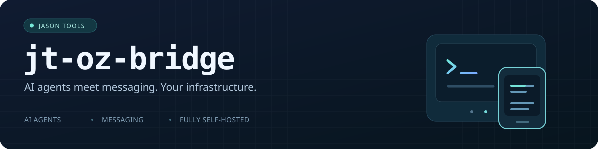
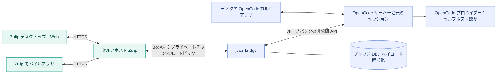

<p align="center">
  
</p>

<h1 align="center">jt-oz-bridge</h1>

<p align="center"><strong>チャットから AI コーディングエージェントと対話する。<br>OpenCode × Zulip、すべて自前のインフラでセルフホスト。</strong></p>

<p align="center">
  
  
  <a href="LICENSE"></a>
  
</p>

<p align="center"><a href="README.md">English</a> · <a href="README_zh-tw.md">繁體中文</a> · 日本語</p>

**AI エージェントを日常の会話に。しかも自分のインフラの上で。** jt-oz-bridge は AI エージェントとメッセージングソフトをつなぐブリッジです。最初の対応は **OpenCode × Zulip** です。Zulip のトピックにタスクを書き込み、エージェントの作業を見守り、スマートフォンから権限リクエストに答え、完全な結果を受け取る。そのすべてを、普段デスクで使っているのと同じ OpenCode セッションの中で行えます。

Zulip、ブリッジ、OpenCode、モデルサーバーはすべて自前の機器で運用できます。OpenCode にセルフホストのモデルサーバー（例：Ollama）を設定すれば、メッセージング、エージェントの実行、推論までを完全にローカルなワークフローとして構成できます。

[特長](#jt-oz-bridge-を使う理由) · [アーキテクチャ](#全体の構成) · [コマンド](#チャットコマンド) · [インストール](#インストールアップグレードアンインストール) · [セキュリティ](#セキュリティモデル) · [開発](#開発クイックスタート) · [テスト](#テストとリリースゲート) · [ドキュメント](#ドキュメント) · [ライセンス](#ライセンス)

> **ステータス：開発プレビュー `0.1.0`。**  
> 本番向けの完成版リリースではありません。コアのルーティング、永続化、セキュリティ境界には大規模な自動テストがあり、フローの一部は実際の OpenCode サーバーと Zulip 組織で確認済みです。ただし、実際の利用者によるエンドツーエンドの受け入れと、公式 iOS／Android アプリでの受け入れは**完了していません**。今後も変更が入る前提で、まずは使い捨てのプロジェクトでお試しください。

---

## jt-oz-bridge を使う理由

| 特長 | できること |
|---|---|
| **日常の会話に AI エージェントを** | タスク、進捗、質問、結果がチャットにまとまり、スマートフォンからもパソコンからも確認できます。 |
| **OpenCode × Zulip** | OpenCode がエージェントとツールを実行し、Zulip がモバイル／デスクトップのチャット、プライベートチャンネル、トピック単位のスレッドを提供します。 |
| **完全セルフホスト** | メッセージング、ブリッジ、エージェント、モデルを自前のハードウェアで動かし、すべてのデータの流れを自分で管理できます。 |
| **コピーではなく同じセッション** | 各トピックは既存の OpenCode セッションに結び付けられます。履歴のコピー、セッションの fork、別バックエンドの起動で継続を装うことはしません。 |
| **スマートフォンから承認** | OpenCode の権限リクエストや質問がトピックに届き、短いコマンドかボタンで答えられます。 |
| **自分のモデルとツール** | OpenCode 自身のカタログからプロバイダー、モデル、バリアントを選べます。既存の MCP 設定もそのまま使えます。 |

OpenCode × Zulip は最初の統合です。ほかの AI エージェントやメッセージング基盤への対応は今後の方向性であり、まだ実装されていません。

## 全体の構成



| コンポーネント | 役割 |
|---|---|
| `jt-oz-bridge serve` | ブリッジ本体。Zulip のイベントを受け取り、認可を確認し、OpenCode API を呼び出して結果を届けます。ヘルスチェック、レディネスチェック、任意の管理画面はループバック（`127.0.0.1:8765`）でのみ待ち受けます。 |
| ブリッジのデータベース | 専用の SQLite データベース（PostgreSQL 対応は開発中）。メッセージのペイロードはアプリケーション層で暗号化します。OpenCode 自身のデータベースは一切開きません。 |
| `jt-oz-bridge observe-serve` | OpenCode ホスト上の `jt-oz-bridge sessions` と `doctor` のための、任意の読み取り専用ローカルオブザーバー。 |
| オーナー／ディレクトリ補助サービス | OpenCode のアカウントで動く標準ライブラリだけの小さなサービス。OpenCode のデータを読まずに、どのプロセス、データセット、プロジェクトディレクトリが本物かを証明します。 |
| 停止通知ユニット | 任意の systemd ユニット。ブリッジが停止したときと復帰したときに Zulip へ 1 回ずつ通知します。 |

OpenCode は非公開のままです。ブリッジの起動、停止、アップグレードによって OpenCode が起動、再起動、置き換えられることはなく、OpenCode で実行中の作業もそのまま続きます。

### 1 トピック = 1 セッション

```text
プライベートチャンネル「project-a」
├── ログイン修正   → 既存の OpenCode セッション A
└── API テスト     → 既存の OpenCode セッション B
```

トピックを作成し、利用を許可された既存のセッションを選ぶ（または登録済みプロジェクトで新しい会話を始める）だけで、あとは入力するだけです。チャンネルのメンバーは全員そのトピックを読めるため、閲覧者が異なるプロジェクトは別のプライベートチャンネルに分けてください。

## 機能と現在の検証範囲

| 領域 | 実装済み | 検証の範囲 |
|---|---|---|
| 元のセッション | 認可された探索、選択、バインド、同一性チェック。OpenCode 再起動後、同じセッションと証明できれば自動で再接続 | 実サーバーで確認済み。パソコン／スマートフォン間の継続の受け入れは未完了 |
| プロンプトとキュー | 送信元の再確認、実行中の返信への追加メッセージ、一時停止／再開、1 回限りの送信、ブリッジ再起動後の追送 | Bot によるチェックは合格。実利用者によるエンドツーエンドの受け入れは未完了 |
| 実行状況 | エージェント作業中は Zulip ネイティブの入力中表示。ツールの進捗はその場で更新 | 開発候補。サーバーとスマートフォンでの表示の受け入れは未完了 |
| モデルとエージェント | OpenCode のプロバイダー／モデル／バリアントのメニューとセッション単位の選択 | カタログのチェックは合格。チャットでの全体フローは未完了。エージェント切り替えは既定で無効 |
| 人による判断 | 権限への回答、AI からの質問、フォーム検証とキャンセル | ローカルのフローと一部のサーバー上での確認。モバイルでの受け入れは未完了 |
| ファイル | `!files`／`!file` で元のバイト列をダウンロード。生成ファイルの自動返送とセッションへのアップロードはセッションごとに有効化 | プレビュー。スマートフォンでのアップロード／ダウンロードの受け入れは未完了 |
| 結果と履歴 | 結果の関連付け、暗号化保存、認可された履歴、長い出力のページ分割 | SQLite のテスト。PostgreSQL の検証は未完了 |
| セキュリティ | プライベートチャンネルの RBAC、プロジェクト単位の付与、トークンのスコープ、ペイロード暗号化、マスキング、失敗時は拒否 | ネガティブテストと一部のホストチェック。セキュリティ全体の受け入れは未完了 |

セッションのライフサイクル、完全な系譜と履歴、ファイル転送、Git と開発操作、リカバリー、管理、運用にはまだ作業が残っています。[互換性マトリクス](docs/COMPATIBILITY.md)（英語）を参照してください。

## チャットコマンド

認可されたプライベートチャンネルで新しいトピックを作り、何か入力します（または `!go` を送信）。会話のボタンをクリックするか、スマートフォンでは `!1`、`!2`… と返信すると接続されます。新しい会話を始めるには `!new` を送ります。あとはタスクを入力するだけです。未接続のトピックでは、通常のテキストには短い案内が返るだけで、AI に届くこともセッションが作られることもありません。

コマンドはすべて `!` と英単語 1 つです。全角の `！` や、スマートフォンのキーボードが付ける大文字でも認識されます。ブリッジからの質問には `!ok` か `!no` で答えます。一覧は[チャットコマンド](docs/COMMANDS.md)（英語）にあり、チャットで `!help` を送っても表示されます。

| コマンド | 用途 |
|---|---|
| そのまま入力 | AI に送信。作業中なら次のステップで AI に届きます |
| `!ok`／`!no` | ブリッジの質問への はい／いいえ。`!ok 1234`／`!no 1234` は権限リクエストへの回答 |
| `!stop`／`!go` | ここでの作業をすべて停止／一時停止中の作業を続行 |
| `!status` | 現在の状態とキュー内のメッセージ |
| `!new`／`!disconnect` | 新しい会話／このトピックの接続を解除（セッションは OpenCode に残ります） |
| `!model`／`!agent` | モデル／エージェントの切り替え |
| `!history`／`!output` | 過去のメッセージ／最新の返信の全文 |
| `!files`／`!file パス` | ファイルの検索／ダウンロード |
| `!undo`／`!redo`／`!discard` | あるメッセージの前まで戻す／元に戻す／完全に削除 |
| 「30 分ごとに … 18:00 まで」の後に `!ok` | タスクをスケジュールで繰り返し送信（既定で無効） |
| `!commit メッセージ`、`!push` | プレビュー、`!ok` の後にエージェントが Git を実行し、ブリッジが結果を確認（既定で無効） |
| `!lang en`／`!lang zh-TW`／`!lang auto` | インターフェースの言語（現在は英語と繁体字中国語） |

デスクトップでは質問の下にボタンが表示されます。スマートフォンのアプリにはボタンが表示されないため、メッセージに書かれたコマンドを入力してください。

## インストール、アップグレード、アンインストール

ブリッジは Linux（systemd）上で、既存の OpenCode サーバーと並べて、専用の非 root ユーザーとして動作します。各リリースは wheel の SHA-256 を名前にした専用ディレクトリに並べてインストールされ、依存パッケージはハッシュで固定され、CycloneDX SBOM が付きます。前のバージョンへ戻すときは、サービスを前のディレクトリに向け直すだけです。

| ガイド | 内容 |
|---|---|
| [インストール](docs/INSTALL_ja.md) | 要件、オンラインおよび**オフライン（エアギャップ）**インストール、チェックサムと SBOM、設定、サービスユーザー、データベース、systemd ユニット、スモークチェック、Zulip の Bot／チャンネルと OpenCode の接続 |
| [アップグレード](docs/UPGRADE_ja.md) | 新リリースの並列インストール、マイグレーション前のバックアップ、切り替え、レディネス確認とロールバック（オンライン／オフライン） |
| [アンインストール](docs/UNINSTALL_ja.md) | ユニット、リリース、状態、シークレットの停止と削除、および Zulip と OpenCode に残るもの |
| [運用](docs/OPERATIONS_SOP.md)（英語） | プロジェクトの登録、機能の有効化、再起動と復旧、トラブルシューティング |

## セキュリティモデル

- **既定は拒否。** セッションに触れられるのは、設定済みの Zulip ユーザー、プライベートチャンネル、プロジェクト単位の付与だけです。Bot のメッセージは無視され、モデルの出力が権限を与えたり自分のリクエストを承認したりすることはできません。
- **実行の直前に再確認。** 何かを送る前に、送信元メッセージ、チャンネルのメンバー、付与、トピックのバインド、対象の OpenCode セッションを改めて確認します。編集、移動、権限取り消しのあった入力は実行しません。結果が不明な操作は確認待ちとして保留し、むやみに再送しません。
- **OpenCode が正であり、非公開のまま。** ブリッジは OpenCode の API をループバック経由で使い、そのデータベースを読むことも再起動することもありません。エージェントに何ができるかは、OpenCode 自身のツール、MCP、OS の権限で決まります。ブリッジの確認はサンドボックスではなく、ホスト上で `sudo` を持つエージェントはその権限を保ったままです。
- **シークレットは参照で。** 認証情報は所有者のみが読めるファイルへの `env:` または `file:` 参照で渡します。ペイロードの暗号鍵はデータベースのバックアップと分けて保管します。エラーメッセージは入力値を表示しません。
- **ファイルはファイルとして。** ダウンロードは元のバイト列をそのまま返します。HTML はファイルのダウンロードとしてのみ提供し、インタラクティブなプレビューはありません。
- **堅牢化されたサービス。** systemd ユニットは専用ユーザーで動き、`NoNewPrivileges`、`ProtectSystem=strict`、`ProtectHome` を有効にし、capability を持ちません。各リリースには SBOM が付き、ハッシュ固定の依存パッケージだけをインストールします。

脆弱性は非公開で報告してください。[SECURITY.md](SECURITY.md)（英語）を参照してください。

## 開発クイックスタート

**前提条件：** `uv`、Python 3.13、同期フォルダー（Nextcloud、NFS、SMB）の外にあるチェックアウト。

```sh
git clone https://github.com/jasoncheng7115/jt-oz-bridge.git
cd jt-oz-bridge
uv sync --locked --python 3.13
uv run jt-oz-bridge --config config.example.toml validate
uv run pytest -q tests
```

`validate` は無効化されたサンプル設定を、接続も認証情報の解決もせずに検査します。鍵、データベース、管理者アカウントを備えたサービスとして動かすには[インストール](docs/INSTALL_ja.md)を参照してください。

## テストとリリースゲート

**機能の追加、機能の変更、バージョンの変更のたびに、完全なテストを新たに実行する必要があります。** 部分的なテストで代用することはできません。

```sh
uv sync --locked
uv run ruff check src tests scripts && uv run ruff format --check src tests scripts
uv run mypy src
uv run pytest -q
uv run python -m scripts.public_gate .
```

継続的インテグレーションはプッシュのたびに同じ手順を実行し、リリースタグではさらに wheel と SBOM を作成します。ファイル権限や時間制限を確認するテストがあるため、実 CPU のマシン上で非 root ユーザーとして実行してください。各リリースには wheel と並べて `jt-oz-bridge-<version>.sbom.cdx.json`（CycloneDX 1.5）が付きます。

合成テストのカバレッジ、合格したテストの数、パッケージのインストール成功は、実サーバーやスマートフォンでの受け入れの完了を意味しません。[テストガイド](docs/TESTING.md)（英語）を参照してください。

## ドキュメント

| ガイド | 内容 |
|---|---|
| [インストール](docs/INSTALL_ja.md) · [アップグレード](docs/UPGRADE_ja.md) · [アンインストール](docs/UNINSTALL_ja.md) | 運用手順（オンライン／オフライン） |
| [Operations](docs/OPERATIONS_SOP.md) | 登録、機能スイッチ、再起動、復旧、トラブルシューティング（英語） |
| [Chat commands](docs/COMMANDS.md) | すべてのコマンドと動作（英語） |
| [Security](SECURITY.md) | 信頼境界、ファイルとプレビュー、デプロイの確認、報告（英語） |
| [Compatibility](docs/COMPATIBILITY.md) | テスト済みのバージョンとサポート範囲（英語） |
| [Testing](docs/TESTING.md) · [変更履歴](CHANGELOG_ja.md) | テストの層、変更ごとに必要な確認、各リリースの変更点 |

ほとんどのドキュメントは英語と繁体字中国語で提供しています。日本語版は README と、インストール、アップグレード、アンインストールの各ガイドです。プロジェクトサイト：<https://jasoncheng7115.github.io/jt-oz-bridge/ja/>。

---

## 関連プロジェクト

セルフホストと自分の環境の管理を軸にした、そのほかの Jason Tools プロジェクト：

| プロジェクト | 内容 |
|---|---|
| [jt-doc-tools](https://github.com/jasoncheng7115/jt-doc-tools) | セルフホストの PDF／Office ドキュメント処理 |
| [jt-ipam](https://github.com/jasoncheng7115/jt-ipam) | インフラと監視に連携する IP アドレス管理 |
| [jt-live-whisper](https://github.com/jasoncheng7115/jt-live-whisper) | ローカルの音声文字起こし、翻訳、会議ツール |

## ライセンス

Copyright © 2026 Jason Tools. jt-oz-bridge は **GNU General Public License v3.0 only**（`GPL-3.0-only`）でライセンスされています。全文は [LICENSE](LICENSE) を参照してください。サードパーティのコンポーネントと保存されている上流のテストソースには、それぞれのライセンスが適用されます。
