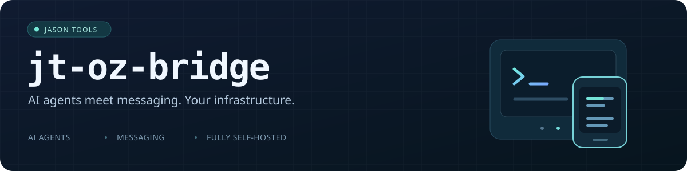
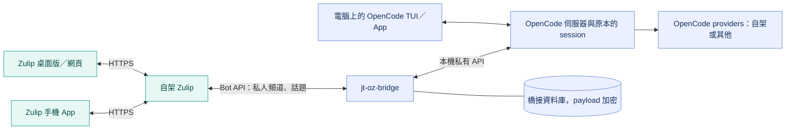

<p align="center">
  
</p>

<h1 align="center">jt-oz-bridge</h1>

<p align="center"><strong>在聊天軟體裡和你的 AI 程式開發 Agent 對話。<br>OpenCode × Zulip，全部地端，自有建置。</strong></p>

<p align="center">
  
  
  <a href="LICENSE"></a>
  
</p>

<p align="center"><a href="README.md">English</a> · 繁體中文 · <a href="README_ja.md">日本語</a></p>

**把 AI Agent 接進日常通訊，讓協作留在自己的環境。** jt-oz-bridge 讓 AI Agent 與通訊軟體溝通，目前從 **OpenCode × Zulip** 開始：在 Zulip 話題輸入任務、看著 Agent 執行、用手機回覆權限確認，並取得完整結果；全程都在你平常在電腦上使用的同一個 OpenCode session 裡進行。

Zulip、橋接服務、OpenCode 與模型伺服器都可以部署在自有設備。在 OpenCode 設定自架模型伺服器（例如 Ollama）後，通訊、Agent 執行與 AI 推論即可串成全地端的工作流程。

[為什麼](#為什麼使用-jt-oz-bridge) · [系統架構](#系統如何配合) · [指令](#聊天指令) · [安裝](#安裝升級與移除) · [資安](#資安模型) · [開發](#開發環境快速開始) · [測試](#測試與發布閘門) · [文件](#文件索引) · [授權](#授權)

> **狀態：開發預覽版 `0.1.1`。**  
> 這不是已完成的正式版本。核心路由、資料保存與資安邊界已有大量自動化測試，部分流程也已在真實的 OpenCode 伺服器與 Zulip 組織上實測。完整的真人端到端驗收與官方 iOS／Android 驗收**尚未**完成。功能仍會調整，請先在拋棄式專案上試用。

---

## 為什麼使用 jt-oz-bridge？

| 重點 | 帶來的改變 |
|---|---|
| **AI Agent 進入日常對話** | 任務、進度、提問與結果集中在聊天裡，手機和電腦都看得到。 |
| **OpenCode × Zulip** | OpenCode 執行 Agent 與工具；Zulip 提供手機／電腦聊天、私人頻道與話題討論串。 |
| **全部地端，自有建置** | 通訊、橋接、Agent 與模型都在自己的硬體上運作，每一段資料流都由自己掌控。 |
| **同一個 session，不是複本** | 每個話題綁定一個既有的 OpenCode session；橋接不複製歷史、不 fork session，也不另起後端假裝接續。 |
| **用手機回覆權限** | OpenCode 的權限要求與提問會出現在話題中，用一個短指令或按鈕回覆即可。 |
| **使用自己的模型與工具** | 從 OpenCode 自己的 catalog 選擇 provider、模型與 variant，沿用既有的 MCP 設定。 |

OpenCode × Zulip 是第一個整合；串接其他 AI Agent 與通訊軟體是延伸方向，目前尚未實作。

## 系統如何配合



| 元件 | 角色 |
|---|---|
| `jt-oz-bridge serve` | 橋接服務：接收 Zulip 事件、檢查授權、呼叫 OpenCode API、回傳結果。只在本機（`127.0.0.1:8765`）提供健康檢查、就緒檢查與選用的管理頁面。 |
| 橋接資料庫 | 自己的 SQLite 資料庫（PostgreSQL 支援開發中），訊息 payload 以應用層加密保存；永遠不開啟 OpenCode 自己的資料庫。 |
| `jt-oz-bridge observe-serve` | 選用的唯讀本機 observer，供 OpenCode 主機上的 `jt-oz-bridge sessions` 與 `doctor` 使用。 |
| Owner 與目錄輔助服務 | 以 OpenCode 帳號執行的小型標準函式庫服務，證明哪個 OpenCode 行程、資料集與專案目錄才是真的，且不讀取 OpenCode 的資料。 |
| 停止通知單元 | 選用的 systemd 單元：橋接停止時在 Zulip 發一則通知，恢復時再發一則。 |

OpenCode 維持私有。啟動、停止或升級橋接，都不會啟動、重啟或取代 OpenCode，OpenCode 中正在進行的工作也會繼續執行。

### 一個話題，對應一個 session

```text
私人頻道「project-a」
├── 修正登入     → 既有 OpenCode session A
└── API 測試     → 既有 OpenCode session B
```

開一個話題，選擇你有權使用的既有 session（或在已納管的專案開新對話），然後直接輸入。同一頻道的成員都能看到其中的話題，因此可見對象不同的專案，要分開使用不同的私人頻道。

## 功能與目前驗證範圍

| 項目 | 已實作 | 驗證界線 |
|---|---|---|
| 原始 session | 授權探索、選擇、綁定與身分檢查；OpenCode 重啟後，能證明是同一個 session 時自動接回 | 已在真實伺服器實測；完整電腦／手機接續驗收待完成 |
| 訊息與佇列 | 來源重驗、執行中追加訊息、暫停／恢復、單次派送、橋接重啟後補送 | Bot 驅動的檢查已通過；真人端到端驗收待完成 |
| 執行狀態 | Agent 工作時顯示 Zulip 原生「輸入中」；工具進度原地更新，重複的步驟改為計數不重貼，連續 5 次時提示一次可用 `!stop`；執行中的一輪 2 分鐘沒有新內容時補一則 ⏳「還在處理中」，並說明是在等工具還是模型；回覆讀入的內容達 6 萬 tokens 時提示一次 💡 開新對話 | 開發候選；伺服器與手機顯示驗收待完成 |
| 模型與 Agent | OpenCode provider／模型／variant 選單與 session 範圍設定 | catalog 檢查已通過；聊天全流程待驗收；Agent 切換預設關閉 |
| 人工決定 | 權限回覆、AI 提問、表單驗證與取消 | 本機流程與局部伺服器實測；手機驗收待完成 |
| 檔案 | `!files`／`!file` 下載原始 bytes；產出檔自動回傳與上傳到 session 需逐一 session 開啟 | 預覽；手機上完整上傳／下載驗收待完成 |
| 結果與歷史 | 結果關聯、加密保存、授權歷史、長輸出分頁 | SQLite 測試；PostgreSQL 資格驗證待完成 |
| 資安 | 私人頻道 RBAC、專案授權、token scope、payload 加密、遮蔽、失敗即拒絕 | 負面測試與局部主機檢查；完整資安驗收待完成 |

對話生命週期、完整 lineage 與歷史、檔案傳輸、Git 與開發操作、恢復、管理及維運仍有待辦，詳見[相容性矩陣](docs/COMPATIBILITY_zh-tw.md)。

## 聊天指令

在已授權的私人頻道開新話題，隨便輸入一句話（或送 `!go`）。點選對話按鈕，或在手機上回覆 `!1`、`!2`… 即可連上；要開新對話則送 `!new`。之後直接輸入任務即可。尚未連線的話題中，一般文字只會收到簡短引導，不會送給 AI，也不會建立 session。

指令一律是 `!` 加一個英文字；中文輸入法的全形 `！` 與手機鍵盤自動加上的大寫也都可以。Bridge 問你的事，回 `!ok` 或 `!no`。完整清單見[聊天指令](docs/COMMANDS_zh-tw.md)，在聊天中送 `!help` 也看得到。

| 指令 | 用途 |
|---|---|
| 直接輸入 | 送給 AI；AI 工作中時，訊息會在它的下一步送達 |
| `!ok`／`!no` | 答應／拒絕 Bridge 問你的事；`!ok 1234`／`!no 1234` 回覆權限要求 |
| `!stop`／`!go` | 停下這裡的全部工作／繼續暫停的工作 |
| `!status` | 目前狀態與排隊中的訊息 |
| `!new`／`!disconnect` | 開新對話／中斷這個話題的連線（session 仍留在 OpenCode） |
| `!model`／`!agent` | 切換模型／Agent |
| `!history`／`!output` | 先前的訊息／最新回覆全文 |
| `!files`／`!file 路徑` | 尋找檔案／下載檔案 |
| `!undo`／`!redo`／`!discard` | 回到某則訊息之前／復原／永久刪除 |
| 「每 30 分鐘 … 到 18:00」，再 `!ok` | 依排程重複送出任務（預設關閉） |
| `!commit 訊息`、`!push` | 先預覽、`!ok` 後由 Agent 執行 Git，Bridge 再檢查結果（預設關閉） |
| `!lang en`／`!lang zh-TW`／`!lang auto` | 介面語言 |

電腦版的提問下方會有按鈕；手機 App 不顯示按鈕，請輸入訊息中寫明的指令。

## 安裝、升級與移除

橋接在 Linux（systemd）上、與既有的 OpenCode 伺服器並行，以專用的非 root 帳號執行。每個版本都並列安裝在以 wheel SHA-256 命名的獨立目錄中，相依套件以雜湊鎖定並附 CycloneDX SBOM；要退回時，只要把服務指回前一個目錄即可。

| 文件 | 內容 |
|---|---|
| [安裝](docs/INSTALL_zh-tw.md) | 需求、線上與**離線（隔離網路）**安裝、checksum 與 SBOM、設定、服務帳號、資料庫、systemd 單元、冒煙檢查、Zulip bot／頻道與 OpenCode 連線 |
| [升級](docs/UPGRADE_zh-tw.md) | 並列安裝新版、遷移前備份、切換、就緒檢查與回滾，線上與離線 |
| [移除](docs/UNINSTALL_zh-tw.md) | 停止並移除單元、版本、狀態與密鑰，以及 Zulip 與 OpenCode 中保留的內容 |
| [維運](docs/OPERATIONS_SOP_zh-tw.md) | 專案納管、開啟功能、重啟與恢復、疑難排解 |

## 資安模型

- **預設拒絕。** 只有設定過的 Zulip 使用者、私人頻道與專案授權能接觸 session。Bot 發出的訊息一律忽略，模型輸出也不能授予權限或核准自己的要求。
- **每次動作前重新檢查。** 送出任何東西前，都會再次確認來源訊息、頻道成員、授權、話題綁定與確切的 OpenCode session；被編輯、移動或撤權的輸入不會執行。結果不明的操作會保留待確認，絕不盲目重送。
- **以 OpenCode 為準，且保持私有。** 橋接透過本機 API 使用 OpenCode，從不讀取其資料庫，也從不重啟它。Agent 能做什麼仍由 OpenCode 自己的工具、MCP 與作業系統權限決定：橋接的確認機制不是 sandbox，若 Agent 在主機上有 `sudo`，它仍保有該權限。
- **密鑰以參照方式提供。** 憑證使用 `env:` 或 `file:` 參照到僅限擁有者讀取的檔案；payload 加密金鑰與資料庫備份分開保存。錯誤訊息不會回顯輸入值。
- **檔案就是檔案。** 下載一律回傳原始 bytes。HTML 只以檔案下載提供，沒有互動式預覽。
- **強化的服務。** systemd 單元以專用帳號執行，啟用 `NoNewPrivileges`、`ProtectSystem=strict`、`ProtectHome` 且不給任何 capability。每個版本都附 SBOM，只安裝鎖定雜湊的相依套件。

發現漏洞請私下回報，詳見 [SECURITY_zh-tw.md](SECURITY_zh-tw.md)。

## 開發環境快速開始

**前置條件：** `uv`、Python 3.13，以及位於同步資料夾（Nextcloud、NFS、SMB）之外的原始碼目錄。

```sh
git clone https://github.com/jasoncheng7115/jt-oz-bridge.git
cd jt-oz-bridge
uv sync --locked --python 3.13
uv run jt-oz-bridge --config config.example.toml validate
uv run pytest -q tests
```

`validate` 只檢查停用的範例設定，不建立連線、不解析憑證。要跑起含金鑰、資料庫與管理帳號的服務，請看[安裝](docs/INSTALL_zh-tw.md)。

## 測試與發布閘門

**每次新增功能、異動功能或變更版本，都必須重新跑一次完整測試。** 局部測試永遠不能取代。

```sh
uv sync --locked
uv run ruff check src tests scripts && uv run ruff format --check src tests scripts
uv run mypy src
uv run pytest -q
uv run python -m scripts.public_gate .
```

持續整合在每次推送都跑同樣的步驟；推送版本 tag 時還會建置 wheel 和 SBOM。請以非 root 帳號、在有實體 CPU 的機器上執行：部分測試會檢查檔案權限與時間限制。每個版本都在 wheel 旁附上 `jt-oz-bridge-<版本>.sbom.cdx.json`（CycloneDX 1.5）。

合成測試、通過數量或套件安裝成功，都不等於在實際伺服器或手機上驗收完成。詳見[測試說明](docs/TESTING_zh-tw.md)。

## 文件索引

| 文件 | 內容 |
|---|---|
| [安裝](docs/INSTALL_zh-tw.md) · [升級](docs/UPGRADE_zh-tw.md) · [移除](docs/UNINSTALL_zh-tw.md) | 維運程序，線上與離線 |
| [維運](docs/OPERATIONS_SOP_zh-tw.md) | 專案納管、功能開關、重啟、恢復與疑難排解 |
| [聊天指令](docs/COMMANDS_zh-tw.md) | 每個指令與用途 |
| [資安](SECURITY_zh-tw.md) | 信任邊界、檔案與預覽、部署檢查、漏洞回報 |
| [相容性](docs/COMPATIBILITY_zh-tw.md) | 已測試版本與支援界線 |
| [測試](docs/TESTING_zh-tw.md) · [變更紀錄](CHANGELOG_zh-tw.md) | 測試層次、每次變更要通過什麼，以及各版本的變更 |

多數文件提供英文與繁體中文；README 及安裝、升級、移除指南另有日文版。專案網站：<https://jasoncheng7115.github.io/jt-oz-bridge/zh-tw/>。

---

## 相關專案

更多以自架與自主掌控環境為核心的 Jason Tools 專案：

| 專案 | 重點 |
|---|---|
| [jt-doc-tools](https://github.com/jasoncheng7115/jt-doc-tools) | 自架 PDF 與 Office 文件處理 |
| [jt-ipam](https://github.com/jasoncheng7115/jt-ipam) | IP 位址管理，整合基礎設施與監控 |
| [jt-live-whisper](https://github.com/jasoncheng7115/jt-live-whisper) | 本機語音轉寫、翻譯與會議工具 |

## 授權

Copyright © 2026 Jason Tools。jt-oz-bridge 採用 **GNU General Public License v3.0 only**（`GPL-3.0-only`）授權，完整條款見 [LICENSE](LICENSE)。第三方元件與保留的上游測試原始碼各自適用其授權。
